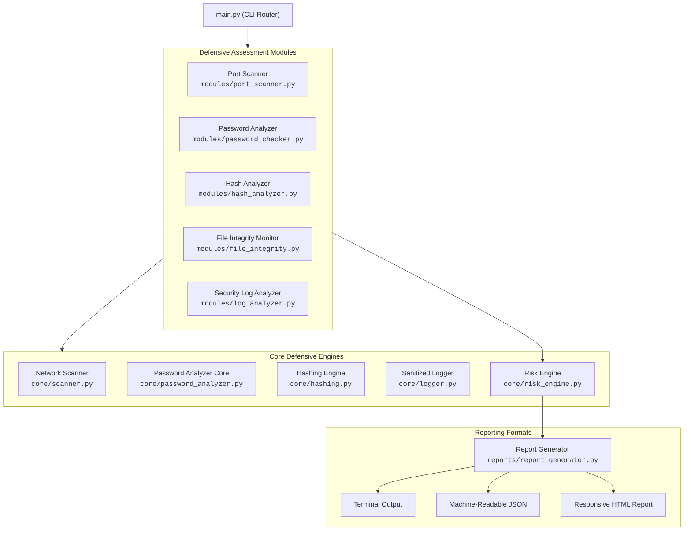

# CyberGuard - Lightweight Cybersecurity Assessment Toolkit

> **A modular, defensive security auditing and risk assessment toolkit built with Python.**

[](https://www.python.org/)
[](LICENSE)
[](tests/)
[](SECURITY.md)
[](https://peps.python.org/pep-0008/)

---

## 📌 Overview

**CyberGuard** is an educational and portfolio-grade defensive cybersecurity assessment toolkit written in clean, modern Python. It demonstrates practical implementations of core defensive security disciplines, including network surface auditing, credential entropy evaluation, cryptographic integrity monitoring, authentication anomaly detection, and transparent risk scoring.

The core assessment engine relies exclusively on the **Python standard library**, ensuring lightweight execution, high maintainability, and zero runtime bloat.

### 💡 Project Heritage & Evolution
This project originated from and expands upon the educational repository [cybersecurity-beginner-project](https://github.com/karansoni15-create/cybersecurity-beginner-project) by [karansoni15-create](https://github.com/karansoni15-create). 

Rather than a simple fork or renaming, CyberGuard represents a **comprehensive architectural redesign and functional expansion**:
- Monolithic scripts with interactive prompts were refactored into a decoupled, object-oriented library.
- Added strict input validation, concurrency management, and structured error handling.
- Introduced new modules: **File Integrity Monitoring (FIM)**, **Authentication Log Analyzer**, **Transparent Risk Engine**, **Credential Generator**, and **Multi-Format Reporting (Terminal, JSON, HTML)**.
- Added a full automated test suite (37 deterministic unit tests) and a sanitized logging system.
- Preserved the original author's legacy scripts in [`legacy/`](legacy/) under the MIT License for educational reference and full provenance.

---

## ✨ Key Features

| Capability | Module | Core Functionality |
|---|---|---|
| **🌐 Network Port Scanner** | `modules/port_scanner.py`<br/>`core/scanner.py` | Controlled TCP connect scanning via `ThreadPoolExecutor`, RFC 1123 target validation, service lookup, and risk tagging. |
| **🔑 Password Analyzer & Generator** | `modules/password_checker.py`<br/>`core/password_analyzer.py` | Shannon & NIST pool entropy calculation, sequential/repetition heuristics, dictionary checks, and CSPRNG generator. |
| **#️⃣ Cryptographic Hashing** | `modules/hash_analyzer.py`<br/>`core/hashing.py` | Multi-algorithm digests (SHA-256, SHA-512, SHA-1, MD5), chunked file streaming, and timing-safe verification. |
| **🛡️ File Integrity Monitoring** | `modules/file_integrity.py` | Cryptographic baseline manifest snapshots, tracking modified, added, and deleted files. |
| **📜 Security Log Analyzer** | `modules/log_analyzer.py` | Detection of brute-force login attempts, success-after-failure anomalies, and privileged account targeting. |
| **⚖️ Risk Engine** | `core/risk_engine.py` | Normalized findings schema and explainable 0–100 security score based on severity point deductions. |
| **📊 Assessment Reporting** | `reports/report_generator.py` | Unified executive reporting across Terminal tables, machine-readable JSON, and responsive standalone HTML. |

---

## 🛡️ Security & Defensive Scope

CyberGuard is strictly engineered for **authorized defensive audits, education, and security verification**:

- **Target Authorization:** Network port scanning must only be performed on systems and subnets you own or have explicit written permission to test. A mandatory authorization warning banner is displayed prior to network operations.
- **Defensive Design:** No exploit payloads, stealth scanning, evasion mechanisms, or destructive operations are implemented.
- **Credential Privacy:** Passwords evaluated by the tool remain strictly in volatile memory. Plaintext passwords are never saved to disk, transmitted over networks, or recorded in log files.
- **Sanitized Logging:** All log entries pass through an active redaction filter in `core/logger.py` to scrub sensitive strings before writing to `logs/cyberguard.log`.
- **Legacy Algorithm Notice:** MD5 and SHA-1 support is provided solely for educational reference and legacy checksum compatibility, with explicit security deprecation warnings displayed.

For vulnerability disclosure and policy guidelines, please review our [SECURITY.md](SECURITY.md).

---

## 🏗️ Architecture

CyberGuard utilizes a layered architecture separating core computational engines from user-facing modules and reporting compilers:



For complete architectural specifications, see [docs/ARCHITECTURE.md](docs/ARCHITECTURE.md).

---

## 📁 Project Structure

```
CyberGuard/
│
├── core/                                # Low-level assessment & security engines
│   ├── __init__.py
│   ├── scanner.py                       # TCP connect scanning & thread pool logic
│   ├── hashing.py                       # Chunked hashing & constant-time comparison
│   ├── password_analyzer.py             # Entropy math & cryptographic credential generation
│   ├── logger.py                        # Centralized logging with credential redaction
│   └── risk_engine.py                   # Transparent 0-100 risk scoring & finding models
│
├── modules/                             # High-level orchestrators & formatters
│   ├── __init__.py
│   ├── port_scanner.py                  # Network scanner workflow & terminal formatting
│   ├── password_checker.py              # Password analysis findings & formatting
│   ├── hash_analyzer.py                 # Multi-digest verification & comparisons
│   ├── file_integrity.py                # FIM baseline generation & differential diffs
│   └── log_analyzer.py                  # Auth log parsing & anomaly detection heuristics
│
├── reports/                             # Reporting subsystem
│   ├── __init__.py
│   └── report_generator.py              # Terminal, JSON, and standalone HTML generators
│
├── tests/                               # Deterministic unit test suite
│   ├── __init__.py
│   ├── test_port_scanner.py             # Mock socket scanning tests
│   ├── test_password_checker.py         # Entropy & weakness pattern tests
│   ├── test_hashing.py                  # Cryptographic vectors & file streaming tests
│   ├── test_file_integrity.py          # Differential modification/addition/deletion tests
│   ├── test_log_analyzer.py             # Brute-force & compromise anomaly tests
│   ├── test_risk_engine.py              # Score calculation & deduction boundary tests
│   └── test_report_generator.py         # Multi-format report validation tests
│
├── samples/                             # Realistic educational artifacts
│   ├── sample_auth.log                  # Sample security authentication event log
│   └── sample_config.txt                # Sample server configuration file
│
├── legacy/                              # Preserved original educational scripts
│   ├── README_ORIGINAL.md
│   ├── caesar_cipher.py
│   ├── hash_generator.py
│   ├── password_strength_checker.py
│   └── port_scanner.py
│
├── docs/                                # Technical documentation
│   └── ARCHITECTURE.md                  # Comprehensive technical design guide
│
├── logs/                                # Local audit logs (cyberguard.log)
├── reports_output/                      # Destination directory for exported reports
├── main.py                              # Unified CLI entry point
├── config.py                            # Central settings, service mappings & thresholds
├── requirements.txt                     # Development and test dependencies
├── pyproject.toml                       # Build & packaging configuration
├── .gitignore                           # Git ignore rules
├── SECURITY.md                          # Vulnerability reporting & responsible disclosure
└── LICENSE                              # Dual-attributed MIT License
```

---

## 🚀 Installation & Setup

### Prerequisites
- Python 3.9 or higher (tested on 3.9 through 3.14).
- Standard terminal shell (Linux, macOS, or Windows WSL/PowerShell).

### 1. Clone the Repository
```bash
git clone https://github.com/the-evilyn/CyberGuard-Lightweight-Cybersecurity-Assessment-Toolkit.git
cd CyberGuard-Lightweight-Cybersecurity-Assessment-Toolkit
```

### 2. Create and Activate Virtual Environment
```bash
# Create virtual environment
python3 -m venv .venv

# Activate on Linux / macOS:
source .venv/bin/activate

# Activate on Windows (Command Prompt / PowerShell):
# .venv\Scripts\activate
```

### 3. Install Test Dependencies
```bash
pip install -r requirements.txt
```

> **Note:** The core runtime requires **no external packages** and runs out-of-the-box using the Python standard library. `pytest` is only required for executing the unit test suite.

---

## 💻 CLI Usage & Examples

Run `python main.py --help` to view all available commands:

```
usage: cyberguard [-h] [--version] [-v] {scan,password,hash,integrity,logs,report} ...
```

### 1. Network Port Scanner
Performs controlled TCP connect port scans with worker thread pools, target resolution, and service risk profiling.

```bash
# Scan common ports on localhost (127.0.0.1)
python main.py scan --target 127.0.0.1 --ports common

# Scan a specific port range with customized timeout and worker count
python main.py scan --target 127.0.0.1 --ports 1-1024 --timeout 0.5 --workers 50

# Scan specific ports and export output to an HTML report
python main.py scan --target 127.0.0.1 --ports 22,80,443 --output reports_output/scan_report.html
```

### 2. Password Security Analyzer & Generator
Analyzes password complexity, estimated entropy, and pattern vulnerabilities without logging or transmitting credentials.

```bash
# Interactive mode (hidden password entry, no terminal echoing)
python main.py password

# Analyze a specific password directly
python main.py password --password "P@ssw0rd123!"

# Generate an 18-character cryptographically strong random password
python main.py password --generate --length 18

# Generate a 4-word Diceware-style memorable passphrase
python main.py password --passphrase --words 4 --separator "-"
```

### 3. Cryptographic Hashing & Verification
Streams files or text strings to generate cryptographic digests with timing-attack safe verification.

```bash
# Calculate all supported hashes (SHA-256, SHA-512, SHA-1, MD5) for a text string
python main.py hash --text "CyberGuardSecurity2026" --all

# Calculate SHA-256 digest of a file
python main.py hash --file samples/sample_config.txt --algo sha256

# Verify a file's integrity against a known digest
python main.py hash --file samples/sample_config.txt --algo sha256 --verify 8b6a24fd1b4f423f71a2503ff01f93d55eab7934f388da8237441b1f4c14b7bb

# Constant-time comparison between two existing hash digests
python main.py hash --compare e3b0c44298fc1c149afbf4c8996fb92427ae41e4649b934ca495991b7852b855 --hash2 e3b0c44298fc1c149afbf4c8996fb92427ae41e4649b934ca495991b7852b855
```

### 4. File Integrity Monitoring (FIM)
Creates and verifies cryptographic baseline manifests across critical directories to detect tampering.

```bash
# Step 1: Create a cryptographic baseline snapshot of a directory
python main.py integrity --create-baseline --path ./samples --manifest ./samples/baseline.json

# Step 2: Verify current directory state against the baseline
python main.py integrity --verify-baseline --path ./samples --manifest ./samples/baseline.json
```

### 5. Security Log Analyzer
Parses authentication logs to detect brute-force attacks, targeted privileged accounts, and suspicious authentication anomalies.

```bash
# Analyze sample authentication log using default threshold (5 failed attempts)
python main.py logs --file ./samples/sample_auth.log

# Analyze with custom threshold and export findings to JSON
python main.py logs --file ./samples/sample_auth.log --threshold 3 --output reports_output/log_report.json
```

### 6. Security Assessment Report Generator
Compiles findings across assessment modules into executive security reports.

```bash
# Display formatted terminal summary
python main.py report --target "Local Security Audit" --format terminal

# Export machine-readable JSON report
python main.py report --target "Local Security Audit" --format json --output reports_output/report.json

# Export styled responsive HTML report
python main.py report --target "Local Security Audit" --format html --output reports_output/report.html
```

---

## 📋 Example Outputs

### Network Port Scanner Output
```
============================================================
⚠️  AUTHORIZATION NOTICE:
Only scan systems and networks you own or have explicit written authorization to test.
Unauthorized port scanning may violate local and international cyber legislation.
============================================================

CyberGuard Network Scanner
===========================
Target: 127.0.0.1 (127.0.0.1)
Ports Scanned: 3

PORT     STATE     SERVICE        RISK      
---------------------------------------------
22       OPEN      SSH            INFO      
80       OPEN      HTTP           LOW       
443      OPEN      HTTPS          INFO      
---------------------------------------------
Scan completed in 0.42 seconds.
Open Ports: 3

Security observations:
- Port 22 (SSH) is OPEN - Encrypted remote administrative shell (verify authentication & key strength).
- Port 80 (HTTP) is OPEN - Unencrypted web server (recommend TLS redirection to HTTPS).
- Port 443 (HTTPS) is OPEN - Encrypted TLS web communications.
```

### Password Security Analysis Output
```
Password Security Analysis
===========================
Score: 82/100
Risk: LOW

Length: 14
Character diversity: GOOD (3/4 classes)
Entropy estimate: GOOD (65.8 bits)
Common pattern: NONE

Recommendations:
- Include special characters (!@#$%^&*).
- Excellent password complexity. Follow regular rotation and use a password manager.
```

### File Integrity Verification Output
```
File Integrity Assessment
==========================
Target: /projects/CyberGuard/samples
Algorithm: SHA256
Status: WARNING - INTEGRITY TAMPERED

Verified files : 2
Modified files : 1
Added files    : 1
Deleted files  : 0
---------------------------------------------

⚠️  MODIFIED FILES:
  - sample_config.txt
    Expected: 8b6a24fd1b4f423f71a2503ff01f93d55eab7934f388da8237441b1f4c14b7bb
    Current : 3e25960a79dbc69b674cd4ec67a72c62d777f2dd58f13da8204d19759d361fa3

➕ ADDED FILES:
  - unauthorized_script.sh (Hash: d41d8cd98f00b204...)
```

### Security Log Analysis Output
```
Security Log Analysis
=====================
Log File: /projects/CyberGuard/samples/sample_auth.log
Total events: 48
Failed logins: 43
Successful logins: 5

Suspicious IPs:
---------------------------------------------

IP: 10.0.0.23
Failed attempts: 31
Successful attempts: 1
Severity: CRITICAL
Targeted users: administrator
⚠️  ALERT: Successful login after multiple failed attempts (possible compromise)!
  - 31 failed login attempts (exceeds threshold of 5)
  - Successful login recorded immediately after consecutive failed attempts
  - Targeted privileged/default accounts: administrator

IP: 192.168.1.50
Failed attempts: 12
Successful attempts: 0
Severity: HIGH
Targeted users: admin, backup, guest, oracle, root, test
  - 12 failed login attempts (exceeds threshold of 5)
  - Targeted privileged/default accounts: admin, backup, guest, oracle, root, test

Targeted Privileged Accounts: admin, administrator, backup, guest, oracle, root, test

---------------------------------------------
Recommendations:
- Review authentication logs for repeated failed logins.
- Enforce rate limiting and account lockout policies for authentication endpoints.
- Implement multi-factor authentication (MFA) across all administrative services.
```

---

## 🔍 Module Deep Dives

### 1. Port Scanner
- **TCP Connect Model:** Uses standard OS non-blocking socket connections (`connect_ex`) to ensure compatibility without requiring root/raw-socket privileges.
- **Controlled Concurrency:** Employs `ThreadPoolExecutor` bounded by configurable worker limits to prevent network thread starvation.
- **Service & Risk Mapping:** Evaluates active ports against a curated catalog of 30+ services (e.g., flagging unencrypted legacy services like Telnet as `CRITICAL` and FTP as `MEDIUM`).

### 2. Password Security Analyzer
- **Entropy Quantification:** Computes both Shannon information entropy and NIST character pool entropy ($E = L \times \log_2(R)$).
- **Pattern Heuristics:** Detects consecutive repeated characters (`aaaa`) and alphabetical or keyboard sequences (`qwerty`, `12345`).
- **Educational Dictionary Matching:** Checks candidates against a local collection of common default passwords.
- **CSPRNG Generator:** Implements `secrets`-backed generators for random passwords and multi-word passphrases with Fisher-Yates array shuffling.

### 3. Hashing & File Integrity Monitoring
- **Streaming Hasher:** Reads files in 64 KB memory chunks via `core/hashing.py`, preventing memory exhaustion when hashing large files.
- **Timing-Attack Resistance:** Employs constant-time string comparisons (`hmac.compare_digest`) for hash verification.
- **Stateful Baselines:** Saves JSON manifests containing relative paths, SHA-256 digests, file sizes, and modification timestamps for differential integrity checks.

### 4. Security Log Analyzer
- **Format Normalization:** Parses pipe-delimited structured logs and Debian/Ubuntu OpenSSH syslog entries.
- **Brute-Force Heuristics:** Groups events by IP and username over configurable threshold windows.
- **Compromise Indicator:** Triggers critical alerts when an IP registers consecutive authentication failures immediately followed by a successful authentication.

### 5. Risk Engine & Report Generator
- **Deductive Scoring Model:** Begins at a clean base score of 100 points. Points are deducted based on finding severity:
  - `CRITICAL`: -35 points
  - `HIGH`: -20 points
  - `MEDIUM`: -10 points
  - `LOW`: -5 points
  - `INFO`: 0 points (informational observation)
- **Multi-Format Export:** Generates ANSI terminal tables, structured JSON, and self-contained responsive HTML reports with CSS badges and score gauges.

---

## 🔄 Example Security Assessment Workflow

A typical defensive audit workflow using CyberGuard:

```bash
# Step 1: Scan local network perimeter for unexpected listening services
python main.py scan --target 127.0.0.1 --ports common

# Step 2: Establish a baseline snapshot of critical service configs
python main.py integrity --create-baseline --path ./samples --manifest ./samples/baseline.json

# Step 3: Parse authentication logs for brute-force attacks or compromise indicators
python main.py logs --file ./samples/sample_auth.log

# Step 4: Generate a unified executive security report
python main.py report --target "Local Host Audit" --format html --output reports_output/audit.html
```

---

## 🧪 Testing

The automated test suite provides complete, deterministic coverage across all modules with zero external network calls:

```bash
# Run all tests
pytest

# Run tests with verbose output
pytest -v
```

```
============================== test session starts ==============================
platform linux -- Python 3.14.4, pytest-9.1.1, pluggy-1.6.0
rootdir: /projects/CyberGuard
configfile: pyproject.toml
testpaths: tests

tests/test_file_integrity.py ....                                        [ 10%]
tests/test_hashing.py .......                                            [ 29%]
tests/test_log_analyzer.py .....                                         [ 43%]
tests/test_password_checker.py .........                                 [ 67%]
tests/test_port_scanner.py .....                                         [ 81%]
tests/test_report_generator.py ...                                       [ 89%]
tests/test_risk_engine.py ....                                           [100%]

============================== 37 passed in 1.07s ==============================
```

---

## 🗺️ Roadmap

- [ ] **Interactive Web UI:** Lightweight local web dashboard for historical audit trend visualization.
- [ ] **Persistent SQLite Storage:** Local database backend to track findings and posture changes over time.
- [ ] **Additional Log Formats:** Ingestion support for Windows Event Logs (`.evtx`), Suricata/Snort EVE JSON, and web access logs (Nginx/Apache).
- [ ] **Passive CVE Mapping:** Correlate extracted service banners with local offline vulnerability databases.
- [ ] **CI/CD Security Check Action:** Pre-built GitHub Action to enforce file integrity and configuration audits during pull requests.

---

## 📄 License & Attribution

This project is licensed under the **MIT License** — see the [LICENSE](LICENSE) file for complete details.

### 👤 Credits & Attribution
- **Original Educational Concept:** [cybersecurity-beginner-project](https://github.com/karansoni15-create/cybersecurity-beginner-project) by [karansoni15-create](https://github.com/karansoni15-create).
- **Architecture, Redesign & Implementation:** Redesigned, refactored, and expanded into **CyberGuard** by [the-evilyn](https://github.com/the-evilyn).
