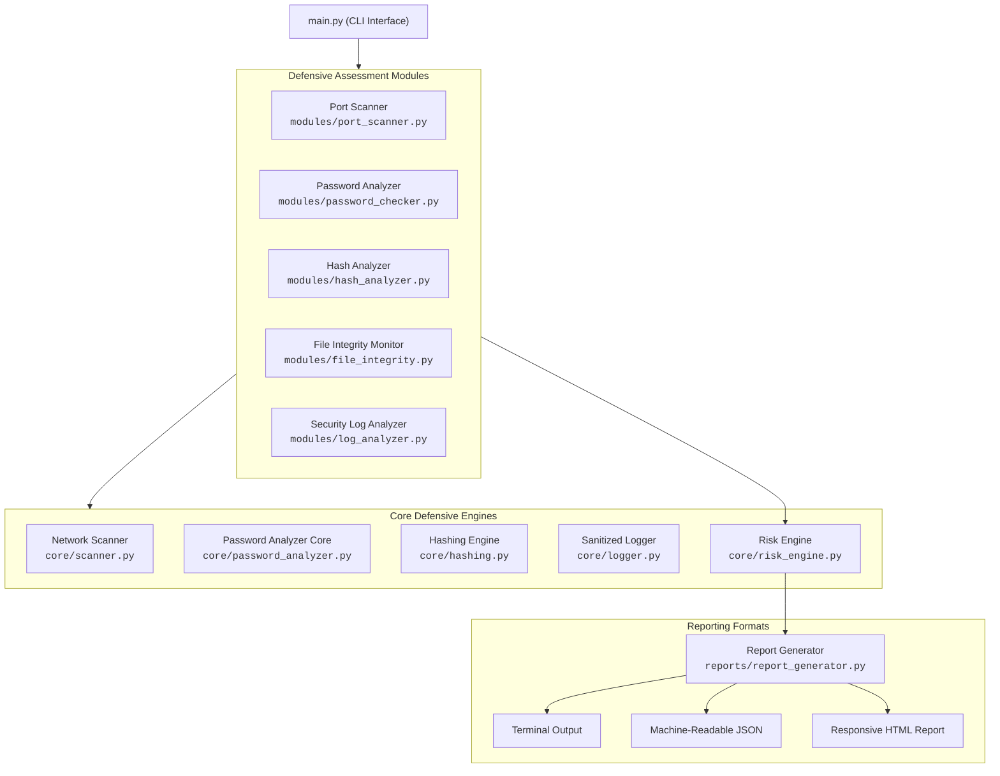

# CyberGuard Technical Architecture & Defensive Design

This document details the architectural principles, defensive security model, risk calculation methodology, and operational workflows implemented across **CyberGuard**.

---

## 1. System Overview & Architecture

CyberGuard follows a layered, decoupled software architecture separating low-level security engines (`core/`) from high-level orchestrators (`modules/`) and output presentation engines (`reports/`).



### Architectural Principles:
1. **Zero External Runtime Bloat:** Core auditing logic is implemented entirely with Python standard library packages (`socket`, `hashlib`, `concurrent.futures`, `secrets`, `ipaddress`, `argparse`).
2. **Defensive Separation of Concerns:** Core modules handle pure computation and diagnostics; presentation and user interaction logic reside exclusively in module formatters and report generators.
3. **Deterministic & Testable:** Every engine accepts explicit parameters and data streams without relying on external cloud APIs or hardcoded filesystem paths.

---

## 2. Defensive Security Model

CyberGuard is engineered exclusively for authorized security verification and defense:

- **Target Authorization:** Network scanning mandates strict host and IP validation, displaying legal authorization banners before execution. Scanning is TCP connect-based; no stealth FIN/XMAS/NULL manipulation, evasion, or aggressive payload injection is supported.
- **Credential Protection:** The password analyzer operates exclusively in local volatile memory. Passwords are never written to disk, sent to external services, or passed to logging handlers.
- **Sanitized Logging:** `core/logger.py` enforces an active `SensitiveDataFilter` that scrubs patterns matching credentials, tokens, and keys from all logging streams prior to writing to `logs/cyberguard.log`.
- **Timing-Attack Resistance:** Cryptographic hash verification utilizes constant-time comparisons (`hmac.compare_digest`) to neutralize timing side-channel analysis.

---

## 3. Risk Engine & Scoring Methodology

The risk engine (`core/risk_engine.py`) employs an explainable, additive deduction model based on findings.

### Severity Deductions
| Severity Level | Point Deduction | Typical Findings |
|---|---|---|
| **CRITICAL** | -35 points | Cleartext Telnet exposed, known default password matched, brute force login success detected |
| **HIGH** | -20 points | SMB/RDP exposed on network, modified baseline system file, aggressive brute force attempts |
| **MEDIUM** | -10 points | Cleartext FTP/IMAP exposed, moderate password entropy, deleted baseline file |
| **LOW** | -5 points | Unencrypted HTTP server, minor password length deficit, routine isolated auth failure |
| **INFO** | 0 points | Encrypted SSH/HTTPS services identified, file integrity verified, clean logs |

### Overall Security Score Formula
$$\text{Score} = \max\left(0, \min\left(100, 100 - \sum \text{Deductions}\right)\right)$$

### Risk Posture Rating Scale
- **90 – 100:** Minimal Risk (Optimal defensive posture)
- **75 – 89:** Low Risk (Acceptable posture with minor configuration improvements)
- **50 – 74:** Medium Risk (Vulnerabilities present requiring attention)
- **25 – 49:** High Risk (Significant exposures requiring immediate mitigation)
- **0 – 24:** Critical Risk (Severe vulnerabilities; immediate action required)

---

## 4. File Integrity Monitoring (FIM) Workflow

The FIM subsystem (`modules/file_integrity.py`) tracks filesystem integrity over time using cryptographic manifests:

```
[Target Filesystem]
         │
         ▼ (create_baseline)
[Compute SHA-256 Hashes] ──► Save JSON Manifest (.cyberguard_baseline.json)
                                        │
                                        ▼ (verify_baseline at later time)
                             [Compare Current State vs Baseline]
                                        │
             ┌──────────────────────────┼──────────────────────────┐
             ▼                          ▼                          ▼
     [Unmodified Files]         [Modified Files]           [Added / Deleted]
      (Integrity Intact)      (Hash Mismatch - High)     (Drift - Medium Risk)
```

1. **Baseline Phase:** Scans target paths and computes SHA-256 digests in 64 KB memory chunks. Stores file relative paths, file sizes, timestamps, and hashes in a baseline JSON manifest.
2. **Verification Phase:** Re-hashes files and compares with the baseline:
   - **Verified:** Digest matches baseline.
   - **Modified:** Digest mismatch indicating potential unauthorized file modification.
   - **Added:** New file not recorded in the baseline.
   - **Deleted:** Baseline file missing from disk.

---

## 5. Security Log Anomaly Detection Logic

The log analyzer (`modules/log_analyzer.py`) identifies attack patterns across structured and syslog/OpenSSH event logs:

1. **Event Normalization:** Ingests log entries into structured `LogEvent` records containing timestamps, client IP, username, and authentication outcome (`SUCCESS` or `FAILURE`).
2. **Heuristic Detection Engine:**
   - **Brute-Force Detection:** Tracks per-IP failure counters. If failures exceed the configured threshold (default: 5), flags the IP as suspicious with severity escalating up to `HIGH` or `CRITICAL`.
   - **Compromise Indicator (Success After Failures):** Detects consecutive failures followed by a successful authentication for the same host. This indicates a potentially cracked account.
   - **Privileged Account Targeting:** Flags attempts against sensitive accounts (`root`, `admin`, `administrator`, `guest`, `oracle`, `postgres`).

---

## 6. CLI Usage Summary

| Subcommand | Core Options | Example |
|---|---|---|
| `scan` | `--target`, `--ports`, `--timeout`, `--workers`, `--output` | `python main.py scan -t 127.0.0.1 -p common` |
| `password` | `--password`, `--generate`, `--length`, `--passphrase` | `python main.py password --generate -l 20` |
| `hash` | `--text`, `--file`, `--algo`, `--verify`, `--compare` | `python main.py hash -f sample.txt -a sha256` |
| `integrity`| `--create-baseline`, `--verify-baseline`, `--path`, `--manifest` | `python main.py integrity --create-baseline -p ./samples` |
| `logs` | `--file`, `--threshold`, `--output` | `python main.py logs -f ./samples/sample_auth.log` |
| `report` | `--target`, `--format` (`terminal`/`json`/`html`), `--output` | `python main.py report --format html -o report.html` |
